# Qualcomm Dragonwing IQ-9075 EVK: first tests

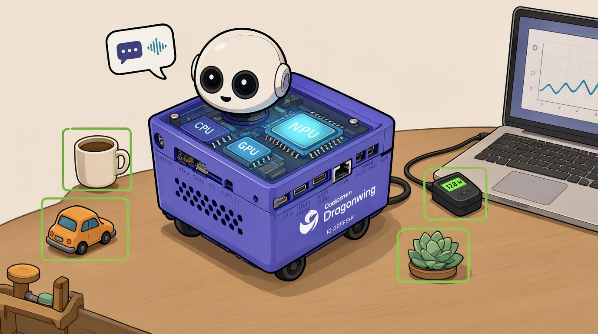

*Cover image generated locally with Qwen-Image 2.1 under the author's direction.*

Oct 14, 2026, updated Oct 26, 2026 with energy measurements · @Marcelo Rovai

In one afternoon, without flashing a new OS, the IQ-9075 EVK showed what a heterogeneous SoC delivers: **the NPU sped up INT8 CNNs by 11 to 95 times, ran object detection at 30 FPS with headroom to spare, and did the prefill of a 4-billion-parameter LLM 18 times faster than the CPU**. Decode, on the other hand, stayed bound by memory bandwidth, whichever processor ran it. A second session, measuring power at the board's input, showed that the **NPU's advantage is even larger in energy: 5 to 70 times less per inference on the vision models, and two-thirds of the CPU's energy per token on LLM decode, at the same speed**.

## The kit

The [IQ-9075 EVK](https://www.qualcomm.com/developer/hardware/qualcomm-iq-9075-evaluation-kit-evk) is Qualcomm's evaluation board for the Dragonwing IQ-9075 SoC, part of the **IQ9 series, aimed at industrial IoT, robotics and Edge AI in demanding environments**. The SoC sits on a module (IQ-9075M) with four PMICs and three LPDDR5 chips, mounted on a mainboard with connectors and slots for mezzanine boards.

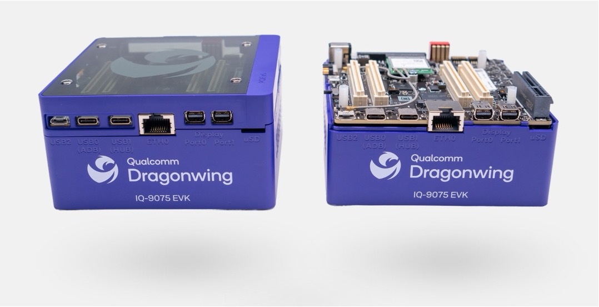

*Image: Qualcomm.*

| Block | Specification |
| --- | --- |
| CPU | 8× Kryo Gen 6 cores, up to 2.36 GHz |
| GPU | Adreno 663 |
| NPU | 2 Hexagon Tensor Processors (HVX + HMX), 100 dense / 200 sparse TOPS (INT8) |
| Real time and safety | 4-core MCU with its own I/Os, plus an isolated Safety Island (SAIL) |
| Memory | 36 GB LPDDR5 at 3200 MHz (96-bit bus), with inline ECC |
| Storage | UFS, 107 GB visible to the OS |
| Video | decode of 1× 8K60 or 4× 4K60 (AV1, H.264, H.265, VP9) |
| Cameras | 4 MIPI CSI ports, plus USB and Ethernet cameras |
| Connectivity | Wi-Fi 6E and Bluetooth 5.3 (NFA765A module), 2.5GbE, CAN-FD |
| Power | 2.10 mm barrel jack, 12 V to 36 V |
| Software | Qualcomm Linux (Yocto) or Ubuntu 24.04, with 10+ years of longevity support |

Two details deserve attention. The IQ-9075 comes in two variants, 50 TOPS (two PMICs) and 100 TOPS (four PMICs), and the EVK uses the 100 TOPS one. And theoretical memory bandwidth, estimated from the 96-bit bus at 6400 MT/s, is around 77 GB/s. That number, not the TOPS, explains most of the LLM results.

The mainboard concentrates the connectors used in this article: the barrel power input, the SW2 DIP switch that puts the board in flashing mode, the USB0 port used for flashing, the mini DisplayPorts for the monitor, and the camera inputs.

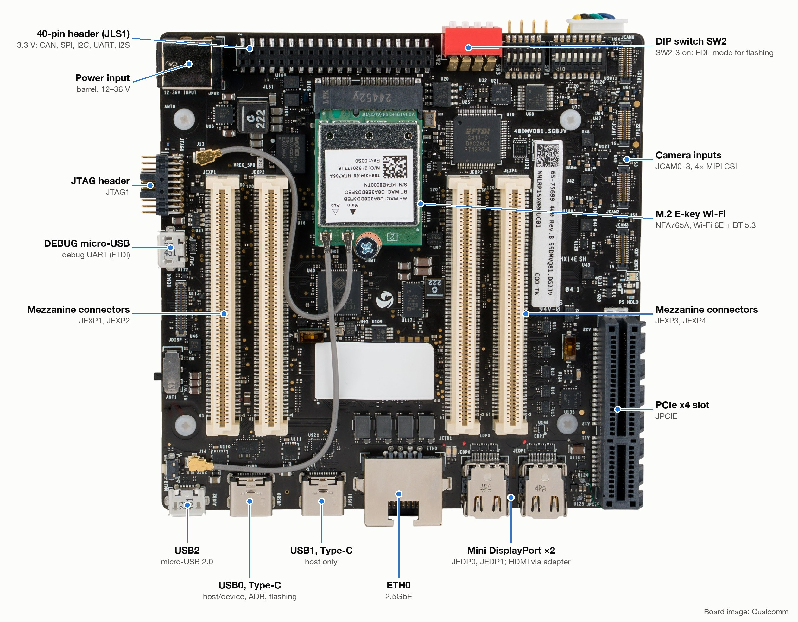

*Board image: Qualcomm; labels added for this article.*

## Where it fits

The IQ-9075 doesn't compete on raw power with NVIDIA's top line; its edge is a dense NPU, ECC memory, a real-time subsystem, and an industrial lifecycle. The table uses reference values from vendor spec sheets; check them before citing.

|  | Arduino UNO Q | Arduino VENTUNO Q | Raspberry Pi 5 | Jetson Orin Nano Super | Jetson AGX Orin 64GB | IQ-9075 EVK |
| --- | --- | --- | --- | --- | --- | --- |
| Class | SBC + MCU, education | SBC + MCU, AI and robotics | general-purpose SBC | entry Edge AI | high-end Edge AI | industrial Edge AI |
| CPU | 4× A53 (QRB2210) + STM32U585 | 8× Kryo Gen 6 (IQ-8275) + STM32H5F5 | 4× A76 | 6× A78AE | 12× A78AE | 8× Kryo Gen 6 |
| AI accelerator | no dedicated NPU | Hexagon NPU | none (Hailo via AI HAT+) | Ampere GPU | Ampere GPU + DLA | Hexagon NPU |
| Stated AI (INT8) | — | 40 dense TOPS | 13–26 TOPS with HAT | \~67 sparse TOPS | \~275 sparse TOPS | 100 dense / 200 sparse |
| RAM | 2–4 GB | 16 GB | up to 16 GB | 8 GB | 64 GB | 36 GB with ECC |
| Real-time | yes (MCU) | yes (MCU) | no | no | no | yes (MCU + SAIL) |
| AI ecosystem | App Lab, Edge Impulse | App Lab, Ubuntu/Debian | broad | CUDA, TensorRT | CUDA, TensorRT | QNN/QAIRT, LiteRT, AI Hub, GenieX, Edge Impulse |

Two caveats. NVIDIA quotes sparse TOPS while Qualcomm highlights dense ones; on a sparse basis, the IQ-9075 sits between the Orin Nano and the AGX Orin. And for LLMs, what matters is memory bandwidth: about 77 GB/s on the IQ-9075 versus about 205 GB/s on the AGX Orin.

There is also a teaching continuity: the Arduino UNO Q uses an entry-level Dragonwing (QRB2210), and the Arduino VENTUNO Q steps up to a Dragonwing IQ8 (IQ-8275), a smaller sibling of the IQ-9075 with the same Kryo Gen 6 CPU family and a Hexagon NPU. The same software ecosystem spans from the lab kit to the industrial board.

## First contact: the factory image

The board arrived with Qualcomm Linux 1.6 already flashed, not empty as some documentation pages suggest. It is Qualcomm's Yocto distribution, with a Weston/Wayland desktop and a complete set of AI tools. Connected to a monitor (HDMI through an adapter), a keyboard and Wi-Fi, it opens a graphical terminal as root.

### SSH access

Typing on the board's terminal is slow and does not allow pasting, so the first useful step is SSH. The server is already running and Qualcomm Linux's default root password is `oelinux123`:

1. On the board, `ip -4 a` shows the IP of the `wlan0` interface.
2. On the host, `ssh root@<IP>` with the default password.
3. Change the password with `passwd` on first login.

### What the image includes

| Item | Result |
| --- | --- |
| OS | Qualcomm Linux 1.6-ver.1.2.1, kernel 6.6.97 |
| CPU and memory | 8 cores; 34 GiB visible, 32 free at idle |
| Storage | 107 GB UFS, 99 GB free |
| File system | OSTree: `/usr` read-only; `/`, `/var`, `/root` and `/usr/local` writable |
| Multimedia | GStreamer 1.22 with the IM SDK plugins (`qtimltflite`, `qtimlqnn`, `qtimlsnpe`, detection, pose, segmentation) |
| AI runtimes | QNN (CPU, DSP, HTP V73), SNPE, TFLite with QNN delegate, GenAI Transformer libraries |
| Tools | `qnn-net-run`, `snpe-net-run`, `benchmark_model`, `python3` 3.12, `docker` 25 |
| Ready-made models | 10 TFLite and 3 DLC models in `/etc/models`, with configs in `/etc/configs` |
| Missing | `apt`, `pip`, a compiler, `v4l2-ctl` |
| Idle temperature | 42–45 °C on every zone (CPU, NPU, DDR) |

The lack of `apt` and a compiler sets the strategy: anything not in the image comes in through Docker. The bundled models and sample apps, on the other hand, make it possible to measure the NPU without downloading anything.

## Vision: CPU, GPU and NPU

The NPU sped up INT8 convolutional models by 11 to 95 times, but lost to the CPU on the one model dominated by data movement. All tests used TFLite's `benchmark_model` with the models in `/etc/models`, batch 1: CPU with 8 threads (XNNPACK) and NPU through the QNN delegate on the HTP backend, in high-performance mode.

### One model, three processors

On the quantized Inception v3, the whole graph was delegated to the NPU.

| Backend | Mean latency | Throughput | vs CPU |
| --- | --- | --- | --- |
| CPU, 8 threads | 15.4 ms (range 11.7 to 51 ms) | \~65 FPS | 1× |
| Adreno 663 GPU | 62 ms | \~16 FPS | 4× slower |
| Hexagon NPU (HTP V73) | 0.76 ms (std. dev. 15 µs) | \~1,300 FPS | \~20× faster |

The GPU lost because TFLite's GPU delegate works in FP16/FP32 and dequantizes the INT8 model. Beyond speed, the NPU was far more stable, which matters in real-time applications. At about 5.7 GMACs per inference, 0.76 ms works out to roughly 15 effective TOPS, well below the 100 TOPS peak: batch 1 and a small model don't fill the accelerator.

### The ten models in the image

| Model | CPU (ms) | NPU (ms) | Speedup |
| --- | --- | --- | --- |
| face\_attrib\_net\_quantized | 54.15 | 0.568 | 95.4× |
| inception\_v3\_quantized | 13.98 | 0.737 | 19.0× |
| hrnet\_pose\_quantized | 19.79 | 1.261 | 15.7× |
| midas\_quantized | 19.68 | 1.250 | 15.7× |
| deeplabv3\_plus\_mobilenet\_quantized | 62.91 | 5.263 | 12.0× |
| yolox\_quantized | 36.06 | 3.157 | 11.4× |
| face\_det\_lite\_quantized | 4.75 | 0.558 | 8.5× |
| facemap\_3dmm\_quantized | 0.82 | 0.230 | 3.6× |
| yamnet (float) | 0.90 | 0.272 | 3.3× |
| quicksrnetsmall\_quantized | 3.08 | 3.786 | 0.8× |

Three patterns emerge:

- **Compute-heavy INT8 CNNs gain 11 to 95 times.** This is the NPU's sweet spot. The extreme gain on face\_attrib suggests the model uses INT8 operators that XNNPACK handles poorly.
- **Tiny models gain only 3 to 8 times.** The NPU hits a floor of 0.2 to 0.3 ms, the fixed cost of dispatching work to the DSP over FastRPC. yamnet is float and still sped up, because the HTP V73 runs FP16.
- **Super-resolution loses on the NPU.** quicksrnet does little math and moves large input and output images; the time goes to transfers, not compute.

The NPU's gain depends on the model's arithmetic intensity, that is, how much compute it does per byte moved, far more than on peak TOPS.

## Video pipeline: real-time object detection

YOLOX ran at a steady 30 FPS over a 1 min 41 s video, dropping 3 frames out of nearly 2,000, and the limit was the video's own frame rate, not the board. Since YOLOX takes about 3 ms on the NPU, there is roughly ten times headroom for more streams.

The `gst-ai-object-detection` app builds the whole pipeline from a JSON file: hardware H.264 decode, preprocessing, TFLite inference on the NPU (`"runtime": "dsp"`), postprocessing and display through `waylandsink`. To run it over SSH and show it on the board's monitor, point it at the Weston display:

```bash
export XDG_RUNTIME_DIR=/dev/socket/weston
export WAYLAND_DISPLAY=wayland-1
gst-ai-object-detection --config-file=/etc/configs/config_detection.json
```


The logs are noisy and alarming the first time. The HTP compiler warnings (`conv_tile_cost`, `concat`), the GBM `mmap` failures and `Failed to link pad` (the MP4's audio track) are harmless. The useful line is the HTP bandwidth summary: `spill_bytes=0` means the model fit entirely in the NPU's local memory.

### USB camera and Qdemo

The USB webcam showed up as `/dev/video0`, but the factory config (YUY2 at 1920×1080, 30 FPS) failed with `not-negotiated`: at high resolutions, most webcams only deliver 30 FPS in MJPEG. The simplest path was Qdemo ("Experience Application Demo"), Qualcomm Linux's graphical menu that builds the same pipelines with a choice of source and application.

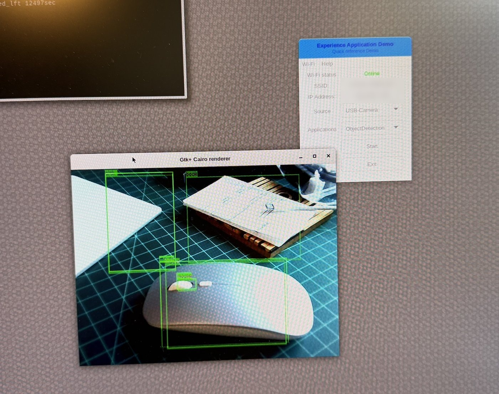

The model's mistakes make good classroom examples. A phone became "remote", pendant lamps became "vase," and a laptop screen became "tv": a COCO-trained detector confuses objects that look like classes it knows. On the live camera, the mouse got two overlapping boxes, a non-maximum suppression (NMS) case that failed to remove the redundant detection at a 40% threshold.

## Local LLMs with GenieX

On a 4-billion-parameter model, the NPU did the prefill 18 times faster than the CPU, but decode was practically the same on both, around 16 to 18 tokens/s. Decode is bound by memory bandwidth; prefill, by compute. The same speed did not mean the same energy, as the energy section shows.

### How to run it

With no `apt` and no compiler, the path was GenieX, which Qualcomm publishes as an ARM64 container for the QCS9075. It offers two runtimes: `llama_cpp`, for GGUF models from Hugging Face, and `qairt`, for precompiled bundles from Qualcomm AI Hub. The container reaches the NPU through `--privileged` and by mounting the host's libraries:

```bash
mkdir -p /root/geniex-data
docker pull docker.io/qualcomm/geniex:latest
docker run -it --rm --privileged \
  -e GENIEX_DATADIR=/data \
  -v /root/geniex-data:/data \
  -v /usr/lib:/opt/qcom-lib:ro \
  docker.io/qualcomm/geniex:latest
```

`GENIEX_DATADIR` is essential: without it, models live inside the container and vanish on every `--rm`. For benchmarks, turn off thinking mode (`--think=false`) and redirect input so the command exits on its own:

```bash
geniex infer <model> -c npu|cpu --think=false --max-tokens 256 -p "<prompt>" < /dev/null
```

The diagram below summarizes the three software paths used in these tests, from the command to the processor.

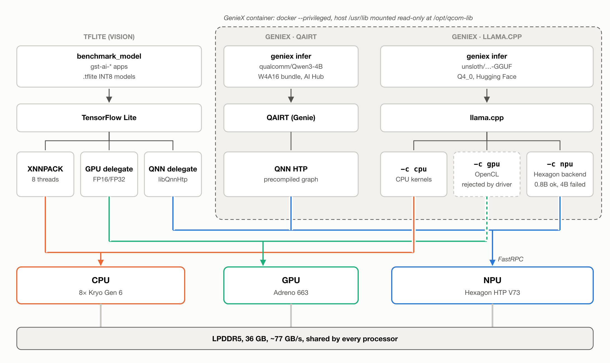

### Results

The short prompt was "Explain in three paragraphs what TinyML is", in Portuguese. The long one had 1,147 Portuguese words, about 2,000 tokens. Time to first token measures prefill.

| Model | Runtime | Prompt | Decode (tok/s) | First token |
| --- | --- | --- | --- | --- |
| Qwen3.5-0.8B Q4\_0 | llama.cpp, NPU | short | 29.7 | 0.1 s |
| Qwen3.5-0.8B Q4\_0 | llama.cpp, CPU | short | 57.1 | 0.1 s |
| Qwen3.5-0.8B Q4\_0 | llama.cpp, NPU | long | 28.4 | 1.7 s |
| Qwen3.5-0.8B Q4\_0 | llama.cpp, CPU | long | 49.4 | 5.1 s |
| Qwen3-4B Q4\_0 | llama.cpp, NPU | short | failed (`SDKError`) | — |
| Qwen3-4B Q4\_0 | llama.cpp, CPU | short | 17.9 | 0.4 s |
| Qwen3-4B W4A16 | QAIRT, NPU | short | 17.9 | 0.1 s |
| Qwen3-4B Q4\_0 | llama.cpp, CPU | long | 13.9 | 31.1 s |
| Qwen3-4B W4A16 | QAIRT, NPU | long | 16.1 | 1.7 s |

The GPU could not be tested: the shader compiler in the host's Adreno driver (qcom-adreno 1.808.11) rejected llama.cpp's OpenCL kernels.

### What the numbers say

- **Decode is memory-bound.** On the 4B model, CPU and NPU both gave 17.9 tok/s. With about 2.3 GB of weights read per token, that is roughly 41 GB/s effective, 55% of the theoretical 77 GB/s. More TOPS do not speed up decode.
- **Prefill is compute-bound.** With the long prompt, the 4B model took 31.1 s to the first token on the CPU and 1.7 s on the NPU: about 65 versus more than 1,000 tokens/s processed. For RAG, agents or document summarization, that is the difference between a usable and an unusable application.
- **Long context also costs at decode.** With 2,000 tokens in the KV cache, decode dropped 22% on the CPU and 10% on the NPU, because each new token reads the weights plus the whole cache.
- **On small models, the CPU wins.** On the 0.8B model, the CPU generated nearly twice the tokens/s of the NPU. With little math per token, the fixed cost of dispatching each layer to the DSP dominates.
- **The right NPU runtime is QAIRT.** llama.cpp's Hexagon backend lost to the CPU on the 0.8B model and failed on the 4B, probably due to a FastRPC session limit with the Qualcomm Linux 1.6 driver. The AI Hub bundle ran without issues.

## Concurrent load: LLM and vision together

With YOLOX processing video at 30 FPS, neither the CPU nor the NPU LLM made the video drop a single frame; the cost showed up only in the LLM, as a 6% to 12% decode slowdown. The test used two SSH sessions: one running `gst-ai-object-detection` on the monitor and another running GenieX with Qwen3-4B on the long prompt.

| LLM (Qwen3-4B) | Prefill alone | Prefill with video | Decode alone | Decode with video | Video |
| --- | --- | --- | --- | --- | --- |
| NPU (QAIRT) | 1.7 s | 1.7 s | 16.1 tok/s | 15.2 tok/s (−6%) | 30 FPS, no extra dropped frames |
| CPU (llama.cpp) | 31.1 s | 33.0 s (+6%) | 13.9 tok/s | 12.3 tok/s (−12%) | 30 FPS, no extra dropped frames |

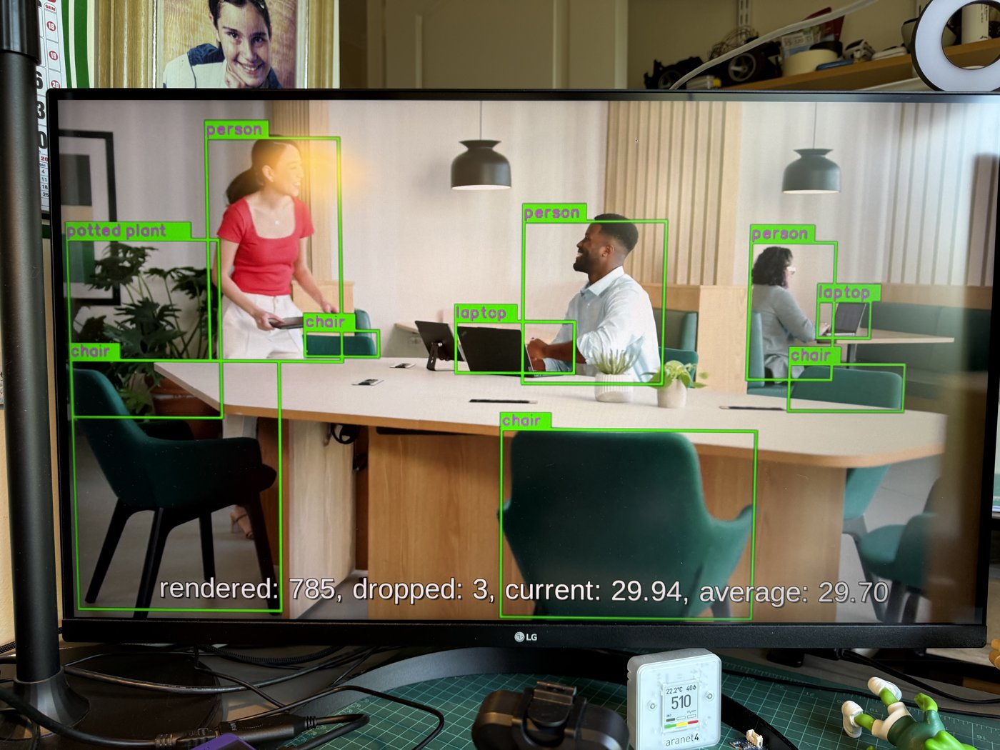

The video did not suffer even with all 8 cores saturated because the vision pipeline barely uses the CPU: decode runs on the VPU, scaling on the GPU, YOLOX on the NPU and composition on the display processor. The CPU only orchestrates. With the LLM also on the NPU, both workloads shared the accelerator with no visible conflict; YOLOX takes about 10% of the NPU's time at 30 FPS.

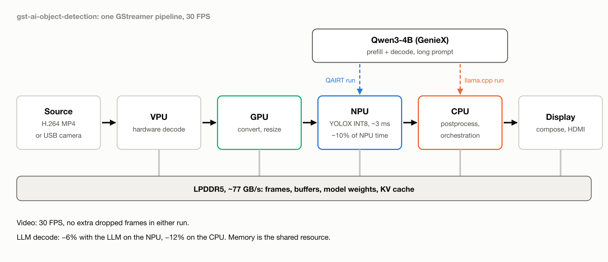

The resource everyone competes for is memory. Decoded video, buffers and inference all read the same LPDDR5, and LLM decode, already bandwidth-bound, is the first to feel it. The CPU lost more, probably because it also competes for cache and scheduling with the GStreamer threads.

## Energy: what each inference costs

Measured at the board's power input, the NPU used 5 to 70 times less energy per inference than the CPU on the vision models, and 20 times less on the prefill of a 4B LLM. Even where it was not faster, it rarely cost more: on 4B decode it matched the CPU's speed with two-thirds of the energy, and on super-resolution, 18% slower, it still used 9% less. The exception was the 0.8B LLM on llama.cpp's Hexagon backend, which lost on both speed and energy.

### How it was measured

The board ran from a USB-C PD charger through a [FNIRSI FNB58](https://www.fnirsi.com/products/fnb58?srsltid=AYCX9vJn3H4qxNnt-ctuGNntIKjP5BoTOqw8r7D8HnN5Q8RrdIP6dGb3) USB meter and a PD trigger cable fixed at 20 V, ending in the barrel jack. The FNB58 sent 100 samples per second to a Mac over its data port, while a script launched each workload over SSH and marked its start and end on the same clock. Energy per inference is the average power over the steady part of each run multiplied by the mean latency. "Total" is everything the board drew; "dynamic" subtracts the idle power measured just before each run.

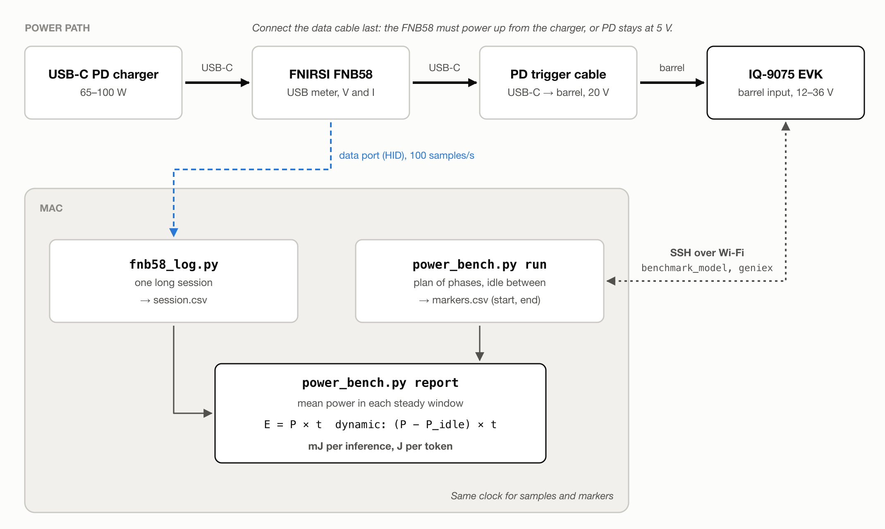

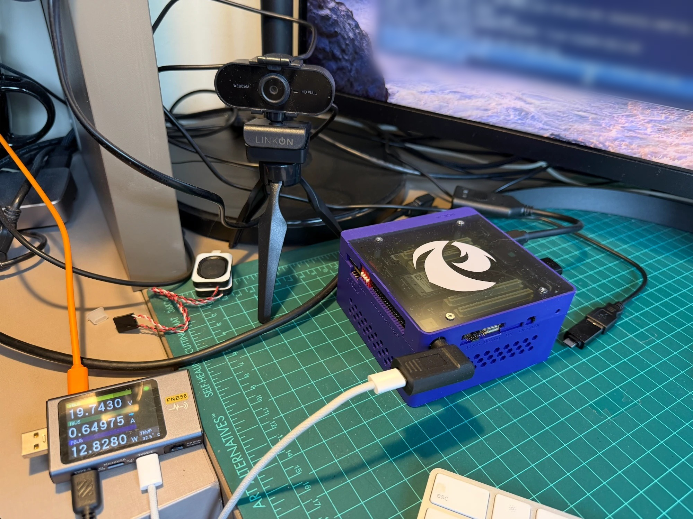

| Configuration | Idle power |
| --- | --- |
| Monitor (HDMI), Bluetooth keyboard and mouse, USB webcam, Wi-Fi | \~8.2 W |
| Wi-Fi only (all measurements below) | 6.6 to 6.9 W, rising slowly as the board warmed |

Two practical notes. The order of connection matters: the trigger cable only negotiated 20 V when the FNB58 powered up from the charger. With the meter already powered by the Mac, the board got stuck at 5 V and did not boot (green LED blinking fast). And on macOS the meter accepted only one logging session per power cycle, so each battery of tests ran under a single long session.

The numbers cover the whole board, not just the SoC: memory, Wi-Fi, fan, and power conversion all count. The comparison between processors holds because everything else stays the same. Repeating Inception v3 on the NPU in a second session gave 10.89 mJ against 10.87 mJ in the first.

### Vision models

Same ten models and settings as the vision tests, with 30 s runs and 20 s of idle between them. Energy is total energy per inference.

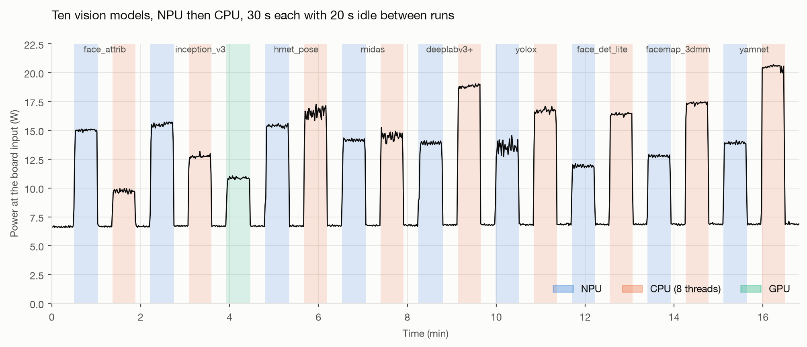

| Model | Speedup (latency) | NPU power | CPU power | NPU energy | CPU energy | Energy ratio |
| --- | --- | --- | --- | --- | --- | --- |
| face\_attrib\_net | 108× | 15.0 W | 9.7 W | 7.5 mJ | 521 mJ | 70× |
| inception\_v3 | 19.9× | 15.5 W | 12.7 W | 10.9 mJ | 177 mJ | 16.3× |
| hrnet\_pose | 17.4× | 15.4 W | 16.6 W | 17.1 mJ | 321 mJ | 18.8× |
| midas | 16.4× | 14.1 W | 14.5 W | 16.6 mJ | 278 mJ | 16.8× |
| deeplabv3\_plus\_mobilenet | 12.0× | 13.9 W | 18.8 W | 71.6 mJ | 1,164 mJ | 16.2× |
| yolox | 11.8× | 13.5 W | 16.8 W | 41.5 mJ | 604 mJ | 14.5× |
| face\_det\_lite | 8.8× | 11.9 W | 16.4 W | 6.3 mJ | 76 mJ | 12.1× |
| facemap\_3dmm | 3.8× | 12.8 W | 17.4 W | 2.8 mJ | 14.3 mJ | 5.1× |
| yamnet (float) | 3.3× | 13.9 W | 20.5 W | 3.6 mJ | 17.2 mJ | 4.9× |
| quicksrnetsmall | 0.85× | 9.7 W | 12.5 W | 35.8 mJ | 39.1 mJ | 1.09× |

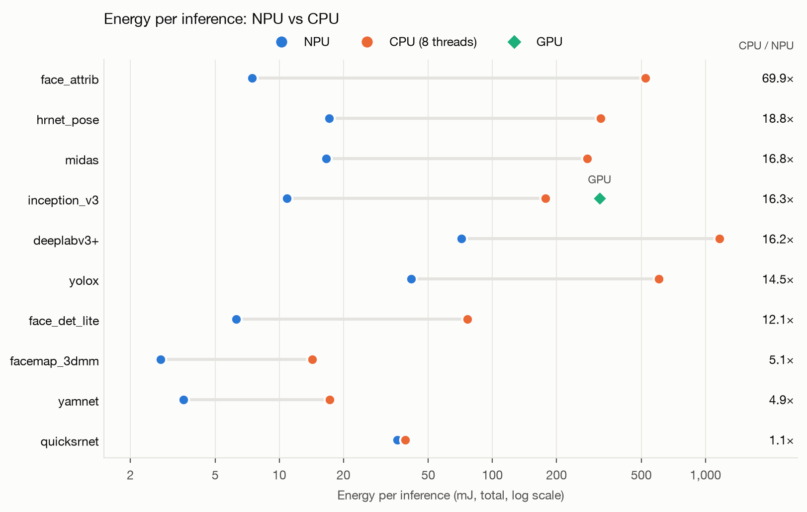

The GPU, tested on Inception v3 only, drew 10.9 W and used 318 mJ per inference: 1.8 times the CPU and 29 times the NPU. Its latency in this run was 29 ms, against 62 ms on October 14; the difference is not explained yet.

- **Power is not energy.** On Inception v3 the NPU drew more power than the CPU (15.5 W against 12.7 W), but it finished each inference 20 times sooner.
- **On most models the energy gain exceeds the speedup.** The NPU drew 12 to 15.5 W, while 8 CPU threads drew 16 to 20.5 W, so the NPU was both faster and lower-power.
- **Tiny models still save about 5 times.** The FastRPC dispatch floor costs time, but little energy.
- **Slower on the NPU did not mean more expensive.** quicksrnet ran 18% slower on the NPU, but at 9.7 W against 12.5 W, so it still used 9% less total energy and 1.65 times less dynamic energy.
- **face\_attrib explains its own speedup.** On the CPU it drew only 9.7 W, 3 W above idle, while the other CPU runs drew 16 to 20 W. The cores were mostly waiting, which supports the guess that XNNPACK runs some of its INT8 operators on slow, poorly parallelized kernels.

### LLMs

Same prompts and models as the LLM tests. The prefill and decode windows were cut from the power trace using the end of generation, stamped inside the container, plus the time to first token and decode rate reported by GenieX.

Decode, short prompt, 256 tokens:

| Model | Runtime, processor | tok/s | Power | Energy per token | Tokens per Wh |
| --- | --- | --- | --- | --- | --- |
| Qwen3-4B W4A16 | QAIRT, NPU | 17.9 | 14.0 W | 0.78 J | \~4,600 |
| Qwen3-4B Q4\_0 | llama.cpp, CPU | 18.4 | 21.2 W | 1.15 J | \~3,100 |
| Qwen3.5-0.8B Q4\_0 | llama.cpp, CPU | 58.0 | 20.1 W | 0.35 J | \~10,400 |
| Qwen3.5-0.8B Q4\_0 | llama.cpp (Hexagon), NPU | 28.5 | 18.8 W | 0.66 J | \~5,400 |

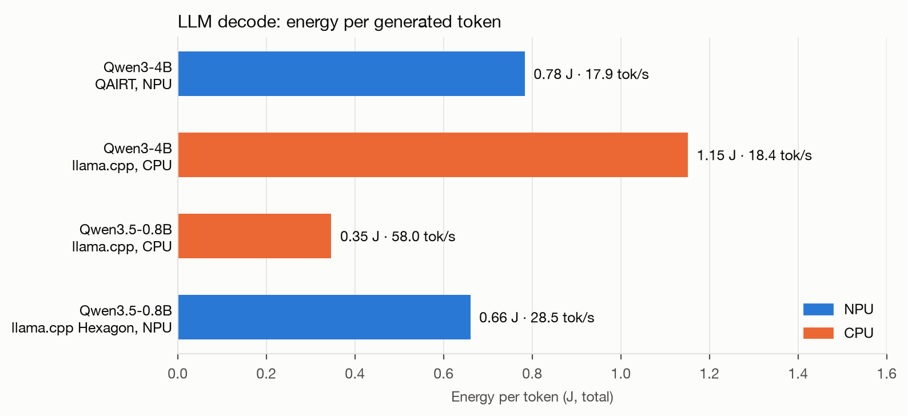

Prefill, long prompt (\~2,000 tokens):

| Model | Runtime, processor | Time to first token | Power | Energy |
| --- | --- | --- | --- | --- |
| Qwen3-4B W4A16 | QAIRT, NPU | 1.7 s | 15.8 W | 27 J |
| Qwen3-4B Q4\_0 | llama.cpp, CPU | 30.7 s | 17.2 W | 529 J |
| Qwen3.5-0.8B Q4\_0 | llama.cpp (Hexagon), NPU | 1.6 s | 19.3 W | 31 J |
| Qwen3.5-0.8B Q4\_0 | llama.cpp, CPU | 5.1 s | 17.4 W | 89 J |

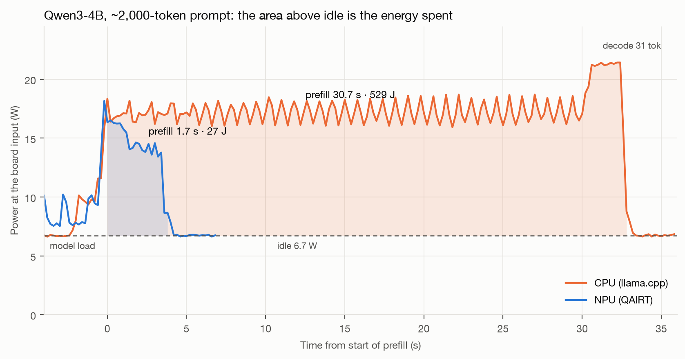

- **4B decode: same speed, two-thirds of the energy.** Both processors hit the same memory-bandwidth ceiling at \~18 tok/s, but the CPU got there at 21 W and the NPU at 14 W. Decode speed is set by memory; decode energy still depends on who does the work.
- **4B prefill: 20 times less energy on the NPU.** A full request, with the long prompt and a 256-token answer, comes to about 230 J on the NPU against 820 J on the CPU, 3.6 times less.
- **On the CPU, decode drew more power than prefill** (21 W against 17 W), although prefill is the compute-bound phase. Keeping the LPDDR5 busy costs power too.
- **On the 0.8B model, the CPU wins decode on both counts:** twice as fast and half the energy per token. llama.cpp's Hexagon backend drew almost as much as the CPU while generating half as fast. For prefill, even this backend saved energy: 31 J against 89 J.
- **The runtime matters for energy as much as for speed.** On the NPU, QAIRT ran the 4B model at 14 W; llama.cpp's Hexagon backend needed 19 W for a model five times smaller.

## Lessons and next steps

On this SoC, the scarce resource for generative AI is memory bandwidth, not TOPS. **A well-designed system puts each workload on its own block: vision on the NPU and VPU, LLM prefill on the NPU, the CPU free for logic and control**. The remaining interference comes from shared memory.

1. **An accelerator's gain depends on arithmetic intensity.** Dense CNNs gain up to 95 times; tiny or I/O-bound models gain little or lose.
2. **An accelerator is not fast at everything.** The GPU was slower than the CPU on INT8 and also used more energy, and the CPU generated text faster and more cheaply than the NPU on a 0.8B LLM.
3. **LLMs have two phases with different bottlenecks.** Prefill is compute-bound and gained 18 times on the NPU; decode is bandwidth-bound and kept the same speed, though not the same energy.
4. **The runtime matters as much as the hardware.** The same 4B model failed on llama.cpp's Hexagon backend and ran well on QAIRT, which also drew less power.
5. **Measure energy, not just speed.** The NPU sometimes drew more power than the CPU, but almost always used less energy per inference; it saved energy even on a model where it was slower.
6. **The factory image is already a complete test platform.** Models, apps, Qdemo and Docker made every test possible without flashing anything.

Next steps: flash Ubuntu 24.04 Server, which brings `apt`, `pip` and the documented path to Edge Impulse and AI Hub; test the Qwen3.5 and Gemma 4 families with llama.cpp, which have no QAIRT bundle for this chip yet, and compare them with the same models on a Raspberry Pi; test several camera streams in parallel with the multistream app; compare the HTP's power modes; and repeat the LLM tests with an 8B model, such as Qwen3-8B, which has a QAIRT bundle for the QCS9075, to find the practical limit of the 36 GB.

## Appendix: reproducible commands

All commands run as root, over SSH, on the factory Qualcomm Linux 1.6 image.

### 1. Diagnostics

```bash
uname -a; nproc; free -h; df -h /
gst-inspect-1.0 | grep -iE "qtiml"
ls /usr/lib | grep -iE "qnn|snpe"
ls /etc/models /etc/configs
for z in /sys/class/thermal/thermal_zone*; do echo "$(cat $z/type): $(cat $z/temp)"; done
```

### 2. CPU vs NPU benchmark of every model

```bash
cat > /root/bench.sh <<'EOF'
#!/bin/bash
SKEL=/usr/lib/rfsa/adsp
export ADSP_LIBRARY_PATH=$SKEL
NPU="backend_type:htp;library_path:/usr/lib/libQnnHtp.so;skel_library_dir:$SKEL;htp_performance_mode:2"
avg() { grep "INFO: count=" | tail -1 | sed 's/.*avg=\([0-9.]*\).*/\1/'; }
printf "%-42s %9s %9s %8s\n" MODEL CPU_ms NPU_ms SPEEDUP
for m in /etc/models/*.tflite; do
  c=$(benchmark_model --graph=$m --num_threads=8 --num_runs=30 2>&1 | avg)
  n=$(benchmark_model --graph=$m --external_delegate_path=/usr/lib/libQnnTFLiteDelegate.so \
      --external_delegate_options="$NPU" --num_runs=100 2>&1 | avg)
  awk -v m="$(basename $m)" -v c="${c:-0}" -v n="${n:-0}" \
    'BEGIN{printf "%-42s %9.2f %9.3f %7.1fx\n", m, c/1000, n/1000, (n>0?c/n:0)}'
done
EOF
chmod +x /root/bench.sh && /root/bench.sh
```

For the GPU, replace the delegate options with `--use_gpu=true`.

### 3. Vision demos

```bash
export XDG_RUNTIME_DIR=/dev/socket/weston
export WAYLAND_DISPLAY=wayland-1
gst-ai-object-detection --config-file=/etc/configs/config_detection.json
gst-ai-pose-detection   --config-file=/etc/configs/config_pose.json
gst-ai-segmentation     --config-file=/etc/configs/config_segmentation.json
```

For the USB camera, copy `/etc/configs/config-usb-camera-app.json`, adjust resolution and format (`mjpeg` at 720p or 1080p) and run `gst-ai-usb-camera-app --config-file=<copy>`. The formats the camera supports show up in `gst-device-monitor-1.0 Video/Source`.

### 4. LLMs with GenieX

The measurements above used a long prompt in Portuguese; the English sentence below gives a comparable load.

```bash
alias gx="docker run -it --rm --privileged -e GENIEX_DATADIR=/data -v /root/geniex-data:/data -v /usr/lib:/opt/qcom-lib:ro docker.io/qualcomm/geniex:latest"
gx
# inside the container:
geniex pull unsloth/Qwen3-4B-GGUF:Q4_0
geniex pull ai-hub-models/Qwen3-4B
for i in $(seq 1 60); do echo "TinyML is the field that brings machine learning to low-power microcontrollers, enabling local inference on sensors."; done > /data/long.txt
echo "Summarize the text above in one sentence." >> /data/long.txt
geniex infer unsloth/Qwen3-4B-GGUF:Q4_0 -c cpu --think=false --max-tokens 64 -i /data/long.txt < /dev/null 2>&1 | tail -2
geniex infer ai-hub-models/Qwen3-4B --think=false --max-tokens 64 -i /data/long.txt < /dev/null 2>&1 | tail -2
```

The container prompt (`root@<id>`) and the board prompt (`root@qcs9075-iq-9075-evk`) are easy to mix up: `docker` exists only on the board, `geniex` only in the container. In interactive chat, `/exit` leaves GenieX; `exit` leaves the container.

### 5. Measuring energy

Connect in this order: USB-C PD charger (unplugged from the wall) → FNB58 → 20 V PD trigger cable → barrel jack. Plug the charger into the wall, check that the FNB58 shows about 20 V and that the board boots, and only then connect the FNB58's data port to the computer.

The logger reads the FNB58 at 100 samples per second through `hidapi` and writes a CSV with time, voltage, current, power, and accumulated energy. It follows the protocol decoded by the [fnirsi-usb-power-data-logger](https://github.com/baryluk/fnirsi-usb-power-data-logger) project. A second script runs each workload over SSH, writes start and end markers, and computes power and energy for each phase. Claude Opus 5.5 (Anthropic) generated both scripts under the author's direction.

```bash
python3 -m venv .venv && .venv/bin/pip install hidapi
.venv/bin/python fnb58_log.py -o session.csv              # one long session; Ctrl+C at the end
python3 power_bench.py run plan_models.txt -m markers.csv  # in another terminal
python3 power_bench.py report session.csv markers.csv
```

Each plan line is `label | seconds | remote command`, and an empty command is an idle phase. For example:

```text
idle-00 | 30 |
inception-npu | 30 | export ADSP_LIBRARY_PATH=/usr/lib/rfsa/adsp; benchmark_model --graph=/etc/models/inception_v3_quantized.tflite --external_delegate_path=/usr/lib/libQnnTFLiteDelegate.so --external_delegate_options='backend_type:htp;library_path:/usr/lib/libQnnHtp.so;skel_library_dir:/usr/lib/rfsa/adsp;htp_performance_mode:2' --num_runs=1 --min_secs={secs} --max_secs={secs} 2>&1
idle-01 | 20 |
```

For LLMs, the remote command runs `geniex infer` inside the container followed by `echo GEN_END=$(date +%s.%N)`, so the end of generation is stamped on the board's clock. In the current GenieX image, the AI Hub model appears as `qualcomm/Qwen3-4B`.

### 6. Switching OS

Flashing Ubuntu erases the factory image. The simplest path is Qualcomm Launcher (GUI, Windows, Linux or macOS). From the command line, with QDL: turn on DIP switch SW2-3 to enter EDL mode, connect USB-C to the USB0 port and flash, in this order, UFS provisioning, CDT, SAIL firmware and the Ubuntu image, following the official guide listed in the sources. The SW2 switch and the USB0 port are labeled in the board image in "The kit" section.

## Sources

- [Qualcomm Dragonwing IQ-9075, product page](https://www.qualcomm.com/internet-of-things/products/iq9-series/iq-9075)
- [Qualcomm IQ-9075 Evaluation Kit (EVK)](https://www.qualcomm.com/developer/hardware/qualcomm-iq-9075-evaluation-kit-evk)
- [Arduino VENTUNO Q, store page](https://store.arduino.cc/products/ventuno-q)
- [Dragonwing IQ-9075 EVK, device overview](https://dragonwingdocs.qualcomm.com/Ubuntu/devices/iq9075-evk/device-overview)
- [Flash Ubuntu using QDL (IQ-9075 EVK)](https://dragonwingdocs.qualcomm.com/Ubuntu/devices/iq9075-evk/update-software/flash-over-qli)
- [Flash Ubuntu using Qualcomm Launcher](https://dragonwingdocs.qualcomm.com/Ubuntu/devices/iq9075-evk/update-software/flash-using-qualcomm-launcher)
- [Day 0 on Dragonwing: verify the setup, then run your first model](https://dragonwingdocs.qualcomm.com/tutorials/day-0-on-dragonwing-first-model)
- [GenieX, Linux installation](https://geniex.aihub.qualcomm.com/en/run/linux/install)
- [Edge Impulse, Qualcomm Dragonwing IQ-9075 EVK](https://docs.edgeimpulse.com/hardware/boards/qualcomm-iq9075-evk)
- [RidgeRun, Why the Qualcomm Dragonwing IQ9](https://developer.ridgerun.com/wiki/index.php/Qualcomm_Dragonwing_Technical_Guide/Introduction/Why_the_Qualcomm_Dragonwing_IQ9)
- [Peridio, IQ-9075 specifications](https://docs.peridio.com/hardware/under-evaluation/iq-9075)
- [fnirsi-usb-power-data-logger (FNB58 protocol)](https://github.com/baryluk/fnirsi-usb-power-data-logger)
- [Qualcomm AI Hub models on Hugging Face](https://huggingface.co/qualcomm)

All measurements were taken by the author on the factory Qualcomm Linux 1.6-ver.1.2.1 image: performance on October 14, 2026, and energy on October 26, 2026, with the `latest` GenieX image from Docker Hub as of each date.


## About this repository

- `figures/`: photos, charts, and diagrams used in this tutorial.
- `tools/fnb58/`: the FNB58 logger (`fnb58_log.py`), the benchmark runner and report (`power_bench.py`), the slicer (`fnb58_slice.py`), the plans run on October 26, and the scripts that draw the charts and diagrams. Set `IQ9075_HOST` and `IQ9075_KEY` to point `power_bench.py` at your board.
- `tools/make_board_figure.py`: the script that labeled the board image. Qualcomm's base image is not included in this repository.
- `tools/pdf/`: builds `iq-9075-tutorial.pdf` from this README with pandoc and WeasyPrint.
- `data/power/`: the raw FNB58 logs (100 samples per second), the phase markers, and the full results in `results.md`.

Python dependencies are in `tools/requirements.txt`. The diagrams also need `rsvg-convert` (librsvg), and the PDF needs `pandoc` and `weasyprint`.

Claude Opus 5.5 (Anthropic) generated the scripts in `tools/`, the charts, and the diagrams under the author's direction. The board images are from Qualcomm and are used with permission. The FNB58 protocol comes from [fnirsi-usb-power-data-logger](https://github.com/baryluk/fnirsi-usb-power-data-logger) (MIT, see `tools/fnb58/LICENSE`).
