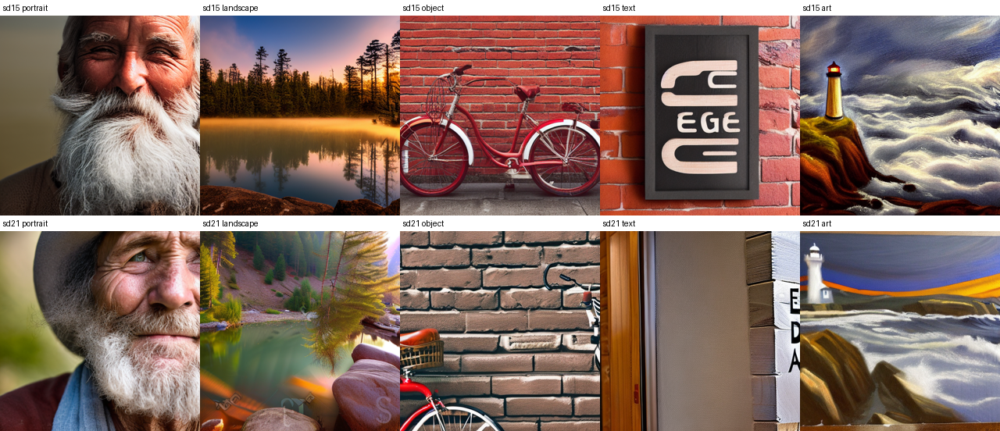

# Stable Diffusion 1.5 and 2.1 on the IQ-9075 NPU

Text-to-image with the Qualcomm AI Hub Stable Diffusion models, pre-compiled for the IQ-9075 (QCS9075, Hexagon HTP v73). All three components run on the NPU: text encoder, UNet, and VAE decoder.



## Setup

- IQ-9075 EVK, Canonical Ubuntu 24.04.5 Desktop, kernel `6.8.0-1089-qcom`, `performance` governor.
- Models: AI Hub Models v0.66.0, `Stable-Diffusion-v1.5` and `Stable-Diffusion-v2.1`, runtime "Precompiled QAIRT ONNX", precision w8a16, chipset `qcs9075`. They were compiled with QAIRT 2.50. Downloaded with:

  ```bash
  qai-hub-models fetch Stable-Diffusion-v1.5 -r precompiled_qnn_onnx -p w8a16 -c qcs9075 --extract -o ~/sd
  ```

  The assets are public and need no AI Hub account.
- Runtime: `onnxruntime` 1.32.0 with the `onnxruntime-qnn` 2.8.0 plugin execution provider (QNN 2.52), in a Python 3.12 venv. HTP performance mode `burst`.
- Script: `sd_run.py`. It follows the AI Hub demo pipeline without PyTorch:
  - CLIP tokenizer from `transformers` (tokenizer files only);
  - classifier-free guidance at scale 7.5, with two UNet calls per step;
  - Euler scheduler for SD 1.5 (AI Hub replaces the default PNDM with Euler);
  - DDIM with v-prediction for SD 2.1;
  - 512 × 512 output, 20 steps.
- Prompts: `sd_prompts.json`, five prompts, seed 42. Each prompt ran twice. Both runs produced byte-identical images, so only one image per prompt is in `images/`.

## Getting the NPU to load the models on Ubuntu

The QNN execution provider failed with `QNN_DEVICE_ERROR_INVALID_CONFIG` until three things were set. The script does all three itself:

- **`LD_LIBRARY_PATH`:** must include the `onnxruntime_qnn` package folder. QNN loads `libQnnHtpV73Stub.so` by its bare name.
- **`ADSP_LIBRARY_PATH`:** must point to the same folder, so the DSP finds `libQnnHtpV73Skel.so`.
- **`libcdsprpc.so`:** Ubuntu ships only `libcdsprpc.so.1`, so `~/sd/lib/libcdsprpc.so` is a symlink to it.

## Results (mean of 10 images per model)

| Model | Text encoder (2 calls) | UNet (40 calls) | VAE decoder | Total per image | Model load |
| --- | --- | --- | --- | --- | --- |
| SD 1.5 | 0.01 s | 4.22 s | 0.20 s | **4.43 s** | 1.8 s |
| SD 2.1 | 0.02 s | 5.87 s | 0.20 s | **6.08 s** | 2.1 s |

- **Stable timing:** the time per image varied by less than 0.03 s across the 10 images of each model.
- **Matches AI Hub:** the UNet works out to 106 ms per call for SD 1.5 and 147 ms for SD 2.1, close to the 102 ms and 142 ms in the AI Hub perf data for this board.
- **The UNet dominates:** fewer steps or no guidance would cut the time almost in proportion.

## Image quality

- **SD 1.5:** good results for the portrait, the landscape, and the oil painting. The bicycle is good, but the wall came out red brick instead of white.
- **SD 2.1:** broken compositions. The lake is fragmented, and the bicycle is cut off at the edge. AI Hub compiles the 768-pixel checkpoint (`sd2-community/stable-diffusion-2-1`) to run at 512 × 512, and this checkpoint is known to give poor results below its training resolution.
- **Text:** neither model wrote "EDGE AI" correctly on the sign. This is a known limit of this generation of models.

## Notes

- The initial noise comes from NumPy (`default_rng(42)`), not PyTorch, so the same seed does not reproduce the images of the official AI Hub demo.
- The timestep input of the SD 1.5 UNet is quantized to a maximum of 968. The first Euler step uses timestep 999, so it is clipped to 968.

## Credits

`sd_run.py` was written by Claude Opus 5.5 (Anthropic), under the direction of Marcelo Rovai.
